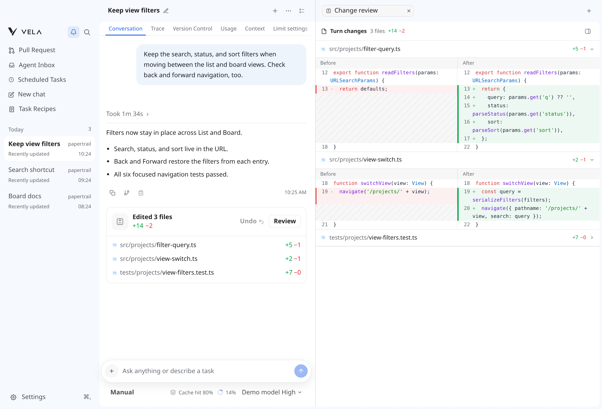
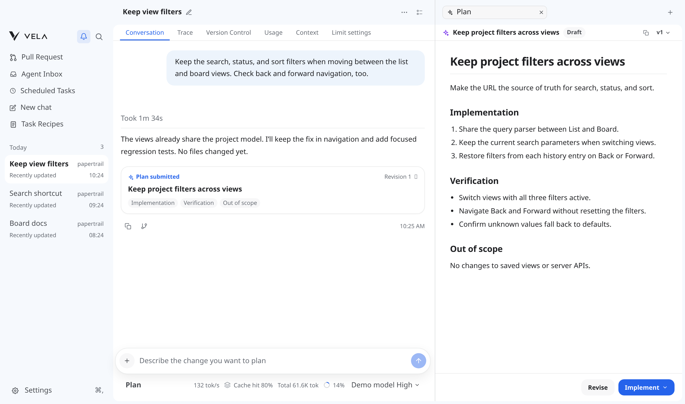
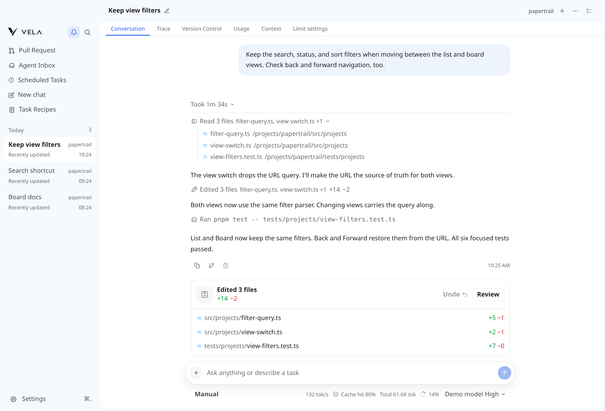
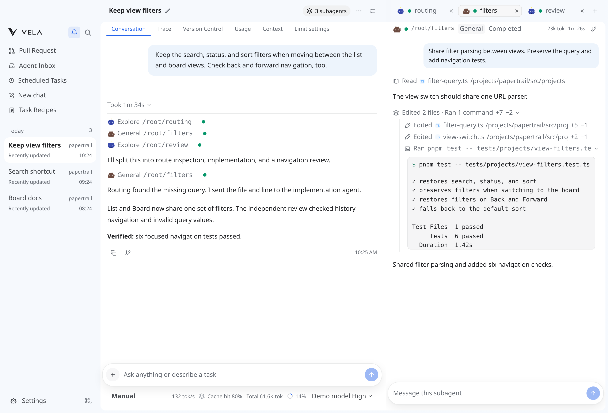
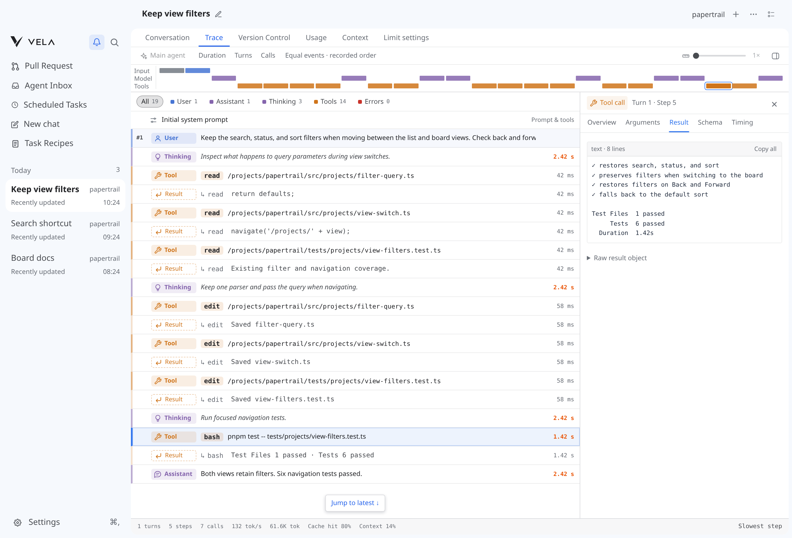
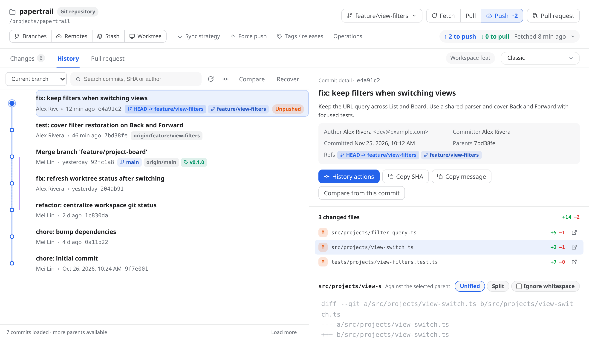
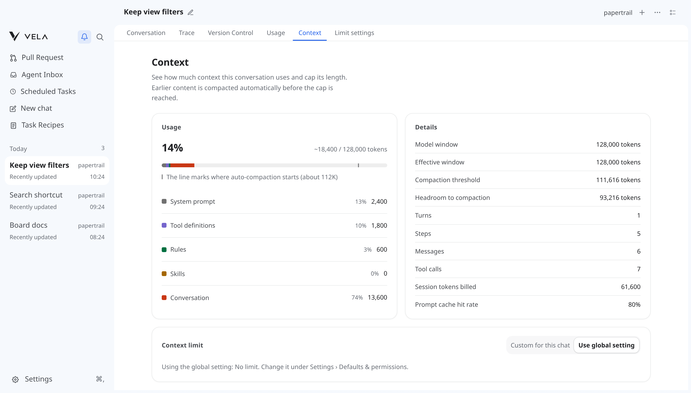
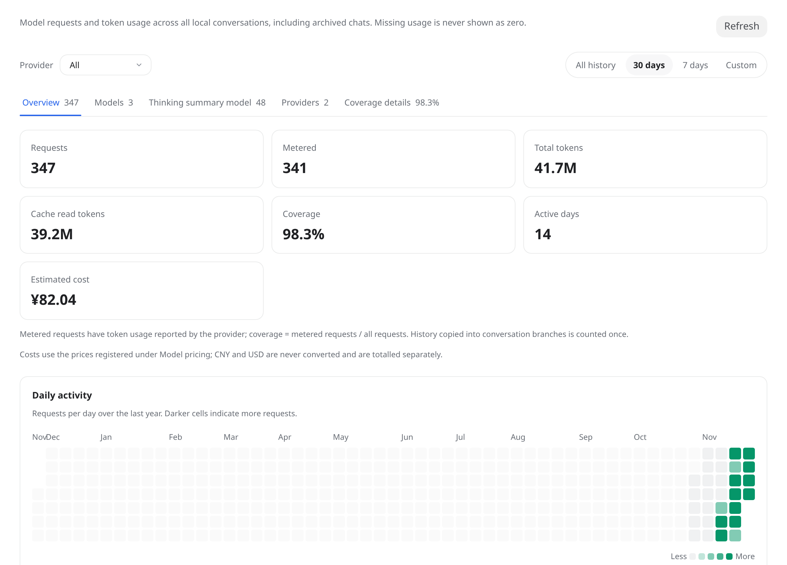
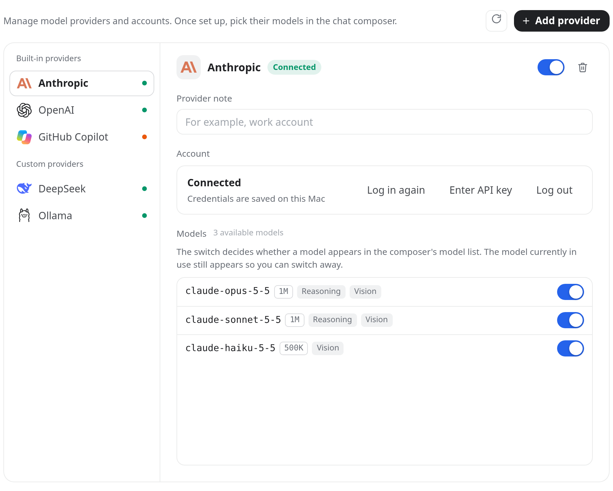
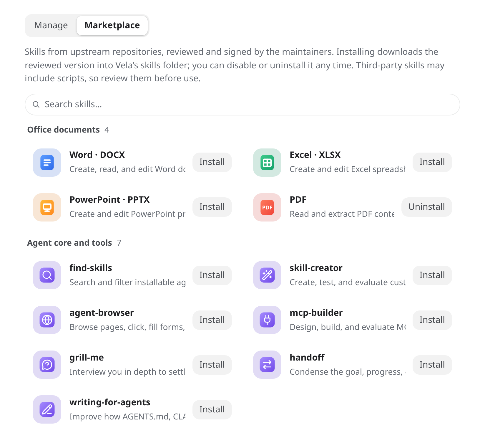

<h1 align="center">Vela</h1>

<p align="center"><strong>ローカルリポジトリで作業するデスクトップ AI コーディングエージェント。</strong></p>

<p align="center"><a href="./README.md">English</a> · <a href="./README.zh-CN.md">简体中文</a> · <a href="./README.zh-TW.md">繁體中文</a> · <b>日本語</b> · <a href="./README.ko.md">한국어</a></p>

<p align="center"><a href="https://github.com/KryptonGao/VelaHarness/releases/latest"><strong>macOS 版をダウンロード</strong></a> · <a href="#ワークフロー">ワークフロー</a> · <a href="#はじめる">はじめる</a> · <a href="./docs/README.md">ドキュメント</a></p>

リポジトリや Git worktree を開いて、Vela に作業を依頼します。まず計画を確認し、並行できる作業はサブエージェントへ。コミットする前に、実際の変更を確認できます。

<p align="center"><a href="./assets/readme/vela-papertrail-review.png"></a><br /><sub>コミット前に、会話の隣でファイルごとの差分を確認します。</sub></p>

## ワークフロー

架空のプロジェクト **Papertrail** では、リストからボードに切り替えるとフィルターが消えてしまいます。この修正を題材に、計画からレビューまでの流れを紹介します。

<table width="100%"><tr><td width="50%" valign="top"><strong>編集前に計画</strong><br /><a href="./assets/readme/vela-papertrail-plan.png"></a><br /><sub>手順やテスト、対象範囲を確認してから実行を承認します。</sub></td><td width="50%" valign="top"><strong>コンパクトモード</strong><br /><a href="./assets/readme/vela-papertrail-compact.png"></a><br /><sub>読み取り、編集、コマンドを展開できる実行ログにまとめます。</sub></td></tr></table>

<table width="100%"><tr><td width="50%" valign="top"><strong>サブエージェント</strong><br /><a href="./assets/readme/vela-papertrail-subagents.png"></a><br /><sub>メインの会話を開いたまま、実装担当の作業を別タブで追えます。</sub></td><td width="50%" valign="top"><strong>トレース表示</strong><br /><a href="./assets/readme/vela-papertrail-trace.png"></a><br /><sub>タイムラインでイベントを選び、コマンド、結果、所要時間を確認します。</sub></td></tr></table>

**Agent** は日常の読み取りや編集に、**Plan** は実行前の計画と承認に、**Goal** は大きな目標に向けた進捗の追跡に使えます。詳しくは [Plan モードのガイド](./docs/features/plan-mode.md)をご覧ください。

## ワークスペースと使用量

Git の履歴やモデルのコンテキストを確認し、リクエスト数とトークン使用量を把握できます。料金は入力した単価から見積もり、人民元と米ドルは別々に集計します。

<table width="100%"><tr><td width="50%" valign="top"><strong>Git 履歴</strong><br /><a href="./assets/readme/vela-papertrail-git.png"></a><br /><sub>ワークスペース内でブランチをたどり、コミットの内容を確認します。</sub></td><td width="50%" valign="top"><strong>コンテキスト</strong><br /><a href="./assets/readme/vela-papertrail-context.png"></a><br /><sub>コンテキストウィンドウの内訳と残り容量を確認できます。</sub></td></tr></table>

<table width="100%"><tr><td width="50%" valign="top"><strong>使用量と費用</strong><br /><a href="./assets/readme/vela-papertrail-usage.png"></a><br /><sub>リクエスト数とトークンを確認し、自分で設定した単価から費用を見積もります。</sub></td><td width="50%" valign="top"><strong>モデルとアカウント</strong><br /><a href="./assets/readme/vela-papertrail-models.png"></a><br /><sub>プロバイダーを管理し、カスタムエンドポイントを追加できます。</sub></td></tr></table>

## Vela を拡張する

繰り返しの作業は、Skill、スケジュール、再利用できるタスクレシピとしてまとめられます。

### Skill マーケットプレイス

<p align="center"><a href="./assets/readme/vela-papertrail-skills.png"></a><br /><sub>再利用できる Skill を探し、エージェントが利用できるものを管理します。</sub></p>

> 画像をクリックすると原寸で表示されます。スクリーンショットは開発スナップショット 5afd78e の実際の画面です。プロジェクト、会話、テスト結果、所要時間、料金はすべて例であり、ベンチマークや公式料金ではありません。macOS のネイティブウィンドウ部分は含みません。

### チャット以外の機能

[スケジュールタスク](./docs/features/scheduled-tasks.md) · [タスクレシピ](./docs/features/task-recipes.md) · [MCP サーバー](./docs/features/mcp.md) · [組み込み連携](./docs/features/built-in-mcp-plugins.md) · [分割ワークベンチ](./docs/features/workbench-split.md) · [内蔵ブラウザー](./docs/features/browser.md)

## はじめる

1. [Releases](https://github.com/KryptonGao/VelaHarness/releases/latest) から **Apple Silicon 搭載 Mac** 向けのビルドをダウンロードします。`.dmg` はインストーラー、`.zip` にはアプリ本体が入っています。`SHA256SUMS.txt` でダウンロードを検証できます。ビルドはアドホック署名で、Apple の公証は受けていません。初回起動がブロックされた場合は[インストールと更新の説明](./docs/guides/updates.md)をご覧ください。
2. **設定 → モデルとアカウント** でプロバイダーにサインインするか、カスタムエンドポイントを追加します。
3. プロジェクトフォルダーまたは worktree を開き、作業モードを選んで変更内容を伝えます。

## 権限とローカルデータ

Vela はローカルワークスペースまたは Git worktree で動きます。手動承認、モデルによる承認補助、フルアクセスから選択できます。これは確認の方法を切り替えるもので、OS レベルのサンドボックスではありません。会話、設定、トレースは `~/.vela` に保存され、開発ビルドでは `~/.vela-dev` を使います。[権限ルール](./docs/features/permission-rules.md)と[ワークスペースのチェックポイント](./docs/features/checkpoints.md)もご覧ください。

## 開発

Node.js 22.19 以上と、リポジトリで固定されている pnpm 11.24.0 が必要です。

```sh
pnpm install
pnpm dev
```

`pnpm build` でビルド、`pnpm test` で型チェックと単体テストを行います。Electron の実画面を確認するには `pnpm test:ui` を使うか、ビルド後に `pnpm test:smoke` を実行します。

Vela は Electron に [Pi Agent SDK](https://github.com/earendil-works/pi) を組み込んでいます。[開発ガイド](./docs/guides/development.md)、[ヘッドレスランナー](./docs/guides/headless-runner.md)、[プロジェクトのドキュメント](./docs/README.md)もご覧ください。

## ライセンス

[Apache-2.0](./LICENSE)
