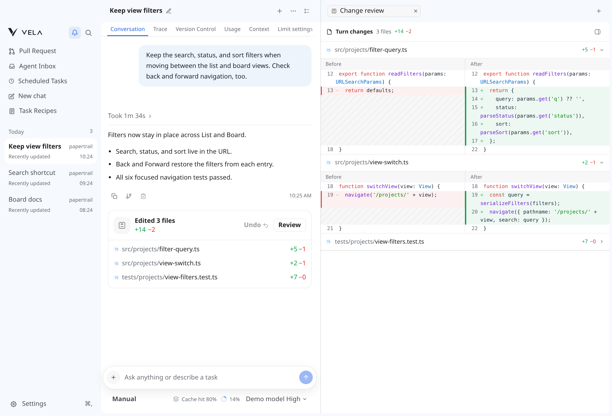
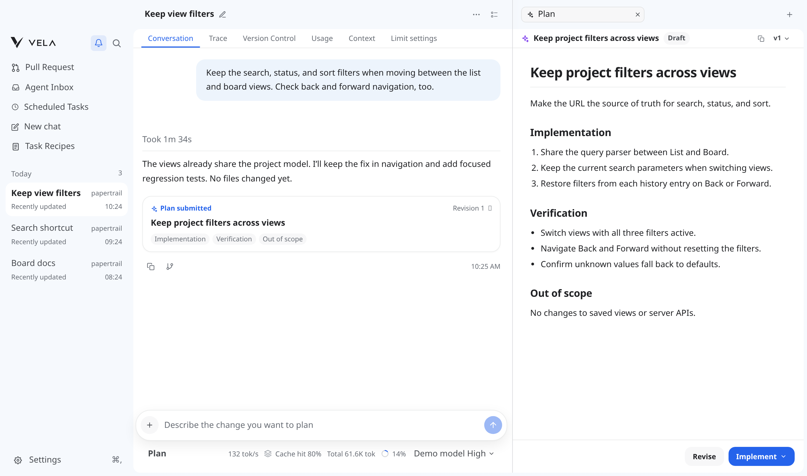
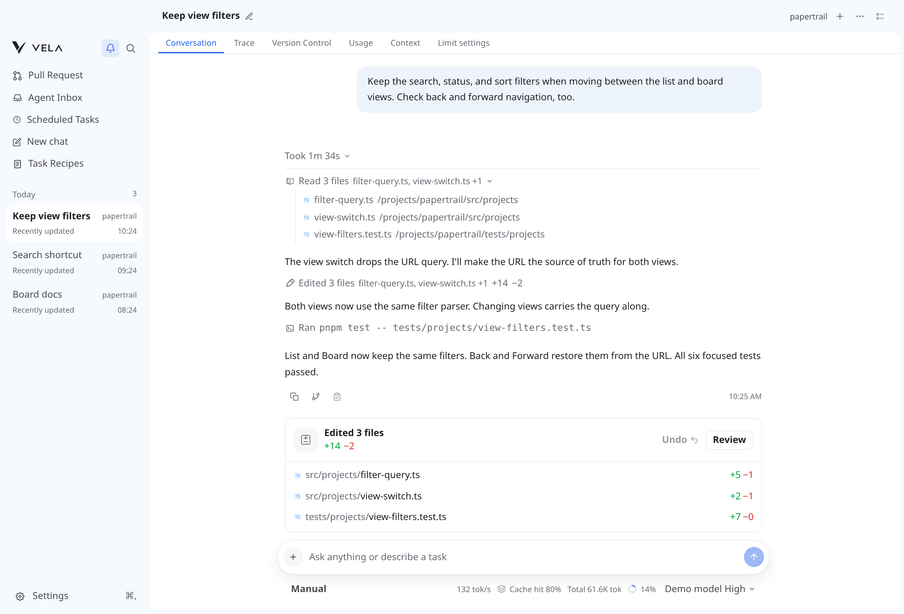
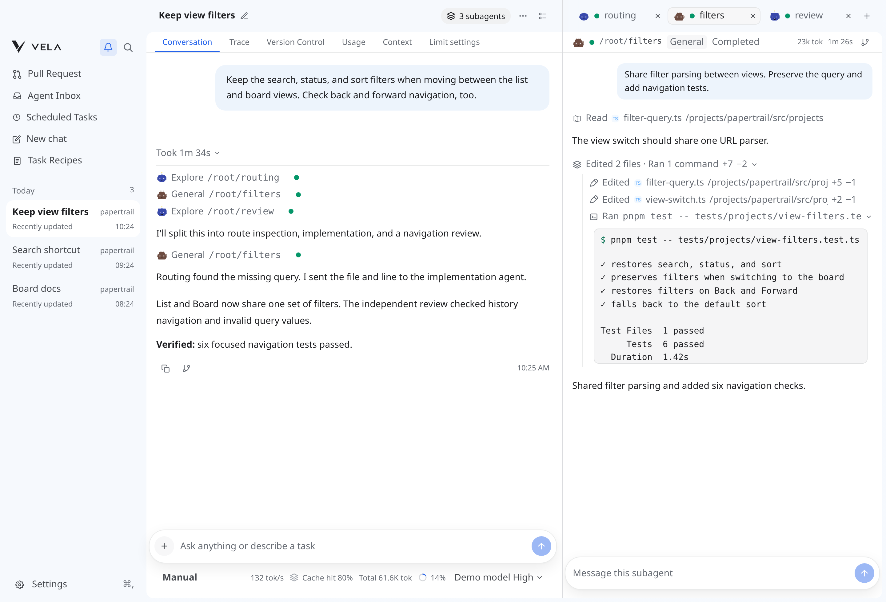
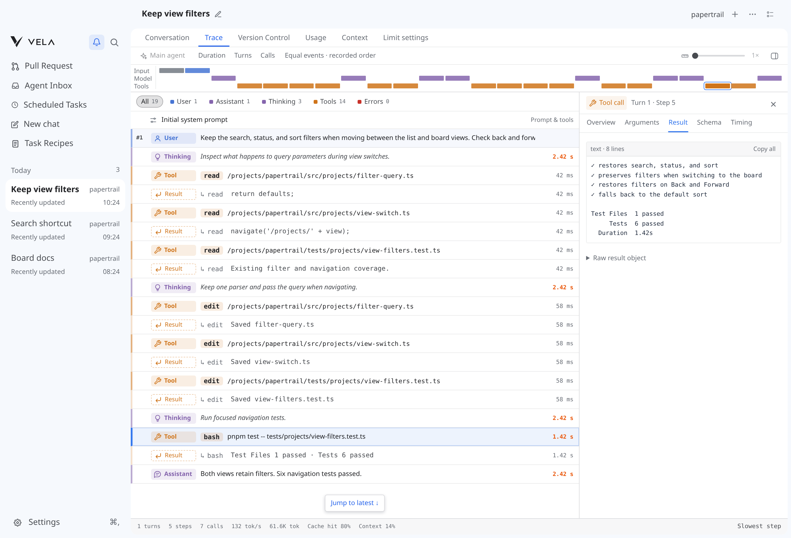
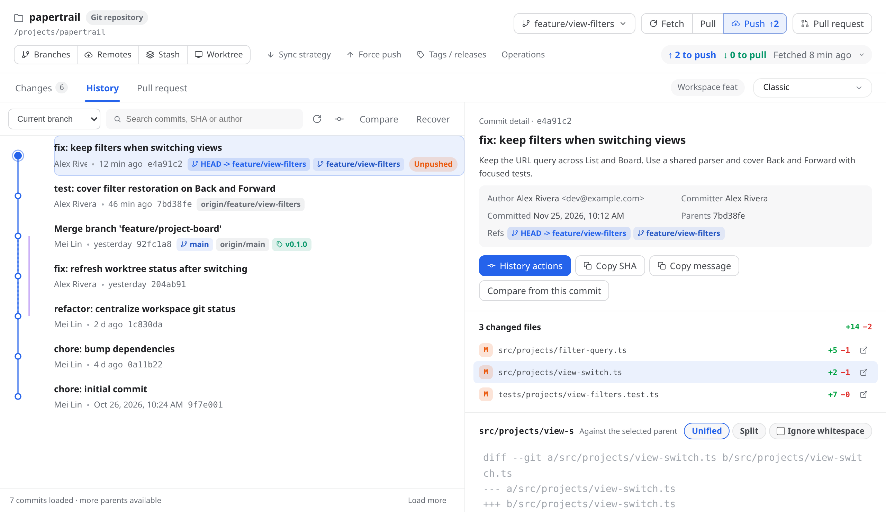
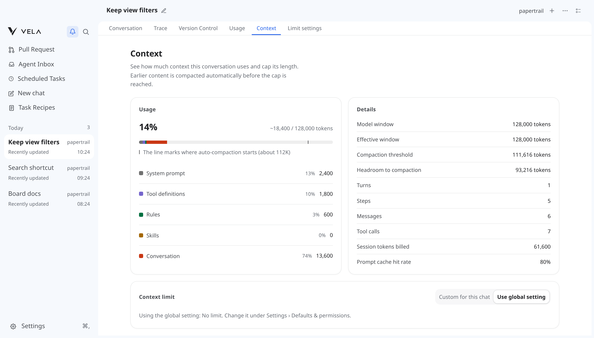
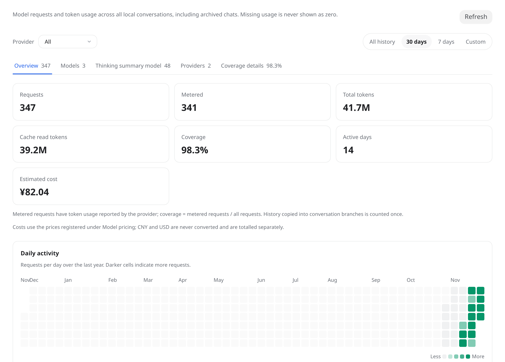
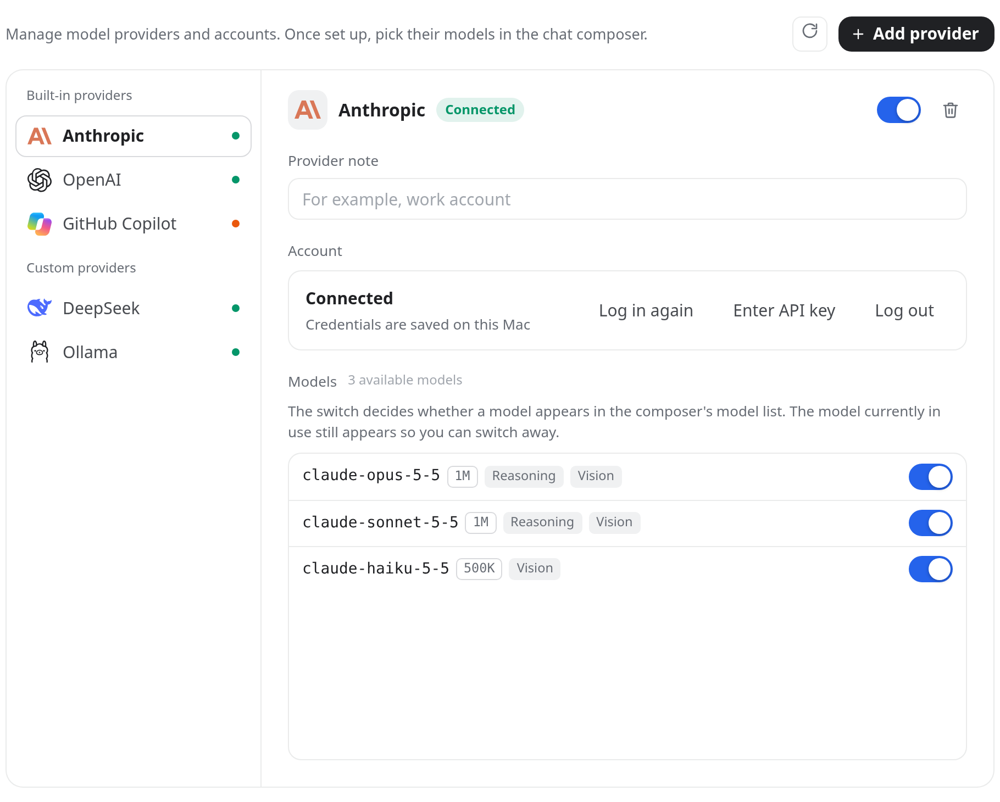
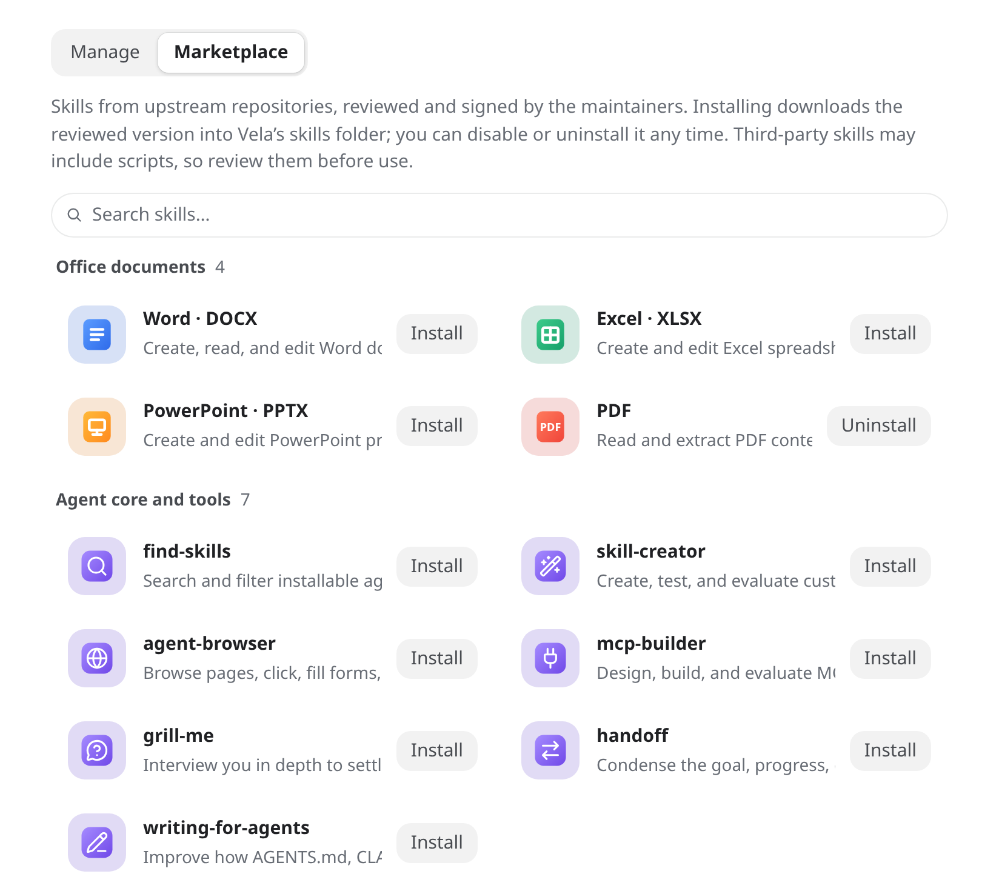

<h1 align="center">Vela</h1>

<p align="center"><strong>로컬 코드 저장소에서 작업하는 데스크톱 AI 코딩 에이전트.</strong></p>

<p align="center"><a href="./README.md">English</a> · <a href="./README.zh-CN.md">简体中文</a> · <a href="./README.zh-TW.md">繁體中文</a> · <a href="./README.ja.md">日本語</a> · <b>한국어</b></p>

<p align="center"><a href="https://github.com/KryptonGao/VelaHarness/releases/latest"><strong>macOS용 다운로드</strong></a> · <a href="#작업-흐름">작업 흐름</a> · <a href="#시작하기">시작하기</a> · <a href="./docs/README.md">문서</a></p>

저장소나 Git worktree를 열고 Vela에 작업을 맡기세요. 먼저 계획을 검토하고, 병렬로 진행할 수 있는 일은 하위 에이전트에 나눈 뒤, 커밋하기 전에 실제 변경 내용을 확인할 수 있습니다.

<p align="center"><a href="./assets/readme/vela-papertrail-review.png"></a><br /><sub>커밋 전에 대화 옆에서 파일별 변경 전후를 비교합니다.</sub></p>

## 작업 흐름

가상의 프로젝트 **Papertrail**에서는 목록에서 보드로 전환하면 필터가 사라집니다. 이 문제를 고치는 과정을 통해 계획부터 변경 검토까지 살펴봅니다.

<table width="100%"><tr><td width="50%" valign="top"><strong>편집 전 계획</strong><br /><a href="./assets/readme/vela-papertrail-plan.png"></a><br /><sub>실행을 승인하기 전에 작업 순서, 테스트, 범위를 확인합니다.</sub></td><td width="50%" valign="top"><strong>간결 모드</strong><br /><a href="./assets/readme/vela-papertrail-compact.png"></a><br /><sub>읽기, 편집, 명령을 펼칠 수 있는 작업 기록으로 모읍니다.</sub></td></tr></table>

<table width="100%"><tr><td width="50%" valign="top"><strong>하위 에이전트</strong><br /><a href="./assets/readme/vela-papertrail-subagents.png"></a><br /><sub>메인 대화 옆 탭에서 구현을 맡은 에이전트의 작업을 확인합니다.</sub></td><td width="50%" valign="top"><strong>트레이스 보기</strong><br /><a href="./assets/readme/vela-papertrail-trace.png"></a><br /><sub>타임라인의 이벤트를 선택해 명령, 결과, 소요 시간을 확인합니다.</sub></td></tr></table>

**Agent**는 일상적인 읽기와 편집에, **Plan**은 실행 전에 계획을 세우고 승인을 받는 데, **Goal**은 더 큰 목표의 진행 상황을 추적하는 데 사용합니다. [Plan 모드 가이드](./docs/features/plan-mode.md)를 참고하세요.

## 작업 공간과 사용량

Git 기록과 모델에 전달되는 컨텍스트를 살펴보고 요청 수와 토큰 사용량을 확인할 수 있습니다. 비용은 입력한 단가로 추정하며, 위안화와 미국 달러는 환산하지 않고 따로 합산합니다.

<table width="100%"><tr><td width="50%" valign="top"><strong>Git 기록</strong><br /><a href="./assets/readme/vela-papertrail-git.png"></a><br /><sub>작업 공간에서 브랜치 그래프와 커밋 내용을 살펴봅니다.</sub></td><td width="50%" valign="top"><strong>컨텍스트</strong><br /><a href="./assets/readme/vela-papertrail-context.png"></a><br /><sub>컨텍스트 창을 채우는 항목과 남은 공간을 확인합니다.</sub></td></tr></table>

<table width="100%"><tr><td width="50%" valign="top"><strong>사용량과 비용</strong><br /><a href="./assets/readme/vela-papertrail-usage.png"></a><br /><sub>요청 수와 토큰을 확인하고 직접 등록한 단가로 비용을 추정합니다.</sub></td><td width="50%" valign="top"><strong>모델 및 계정</strong><br /><a href="./assets/readme/vela-papertrail-models.png"></a><br /><sub>모델 공급업체를 관리하고 사용자 지정 엔드포인트를 추가합니다.</sub></td></tr></table>

## Vela 확장하기

반복하는 작업을 Skill, 예약 작업 또는 재사용 가능한 작업 레시피로 정리하세요.

### Skill 마켓플레이스

<p align="center"><a href="./assets/readme/vela-papertrail-skills.png"></a><br /><sub>재사용할 Skill을 찾아 에이전트에 제공할 항목을 관리합니다.</sub></p>

> 이미지를 누르면 원본 크기로 볼 수 있습니다. 스크린샷은 개발 스냅샷 5afd78e의 실제 Vela 화면입니다. 프로젝트, 대화, 테스트 결과, 소요 시간, 단가는 예시이며 벤치마크나 공급업체의 공식 요금이 아닙니다. macOS 네이티브 창 영역은 포함하지 않습니다.

### 채팅 밖의 기능

[예약 작업](./docs/features/scheduled-tasks.md) · [작업 레시피](./docs/features/task-recipes.md) · [MCP 서버](./docs/features/mcp.md) · [기본 제공 연동](./docs/features/built-in-mcp-plugins.md) · [분할 작업대](./docs/features/workbench-split.md) · [내장 브라우저](./docs/features/browser.md)

## 시작하기

1. [Releases](https://github.com/KryptonGao/VelaHarness/releases/latest)에서 **Apple Silicon Mac**용 빌드를 내려받으세요. `.dmg`는 설치 파일이고 `.zip`에는 앱 번들이 들어 있습니다. `SHA256SUMS.txt`로 파일을 검증할 수 있습니다. 빌드는 임시 서명되어 있으며 Apple 공증을 받지 않았습니다. macOS에서 첫 실행이 차단되면 [설치 및 업데이트 안내](./docs/guides/updates.md)를 참고하세요.
2. **설정 → 모델 및 계정**에서 공급업체에 로그인하거나 사용자 지정 엔드포인트를 추가합니다.
3. 프로젝트 폴더나 worktree를 열고 작업 모드를 선택한 다음 원하는 변경 사항을 설명합니다.

## 권한과 로컬 데이터

Vela는 로컬 작업 공간 또는 Git worktree에서 실행됩니다. 수동 승인, 모델 보조 승인, 전체 접근 중에서 선택할 수 있습니다. 이 설정은 확인 메시지를 제어하며 OS 수준의 샌드박스는 아닙니다. 대화, 설정, 트레이스는 `~/.vela`에 저장되고 개발 빌드는 `~/.vela-dev`를 사용합니다. [권한 규칙](./docs/features/permission-rules.md)과 [작업 공간 체크포인트](./docs/features/checkpoints.md)를 참고하세요.

## 개발

Node.js 22.19 이상과 저장소에 고정된 pnpm 11.24.0이 필요합니다.

```sh
pnpm install
pnpm dev
```

`pnpm build`는 앱을 빌드하고 `pnpm test`는 타입 검사와 단위 테스트를 실행합니다. Electron UI를 확인하려면 `pnpm test:ui`를 실행하거나, 빌드한 다음 `pnpm test:smoke`를 실행하세요.

Vela는 Electron에 [Pi Agent SDK](https://github.com/earendil-works/pi)를 내장합니다. [개발 가이드](./docs/guides/development.md), [헤드리스 러너](./docs/guides/headless-runner.md), [프로젝트 문서](./docs/README.md)도 확인할 수 있습니다.

## 라이선스

[Apache-2.0](./LICENSE)
