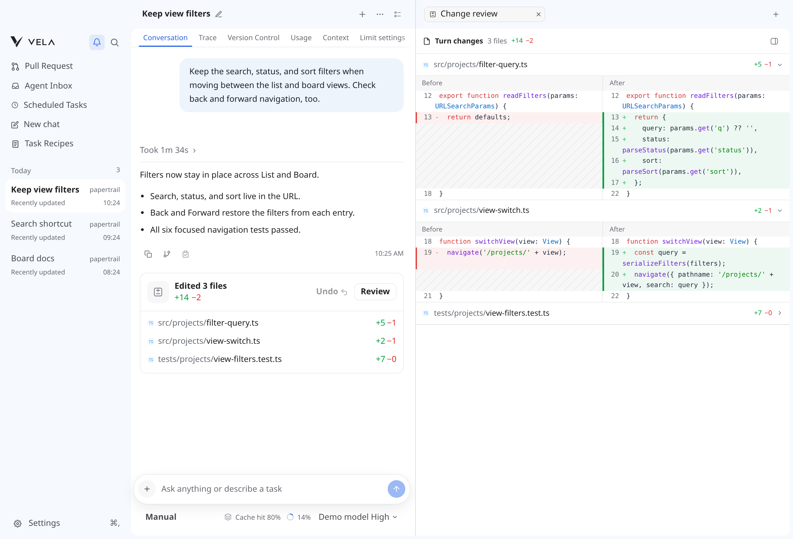
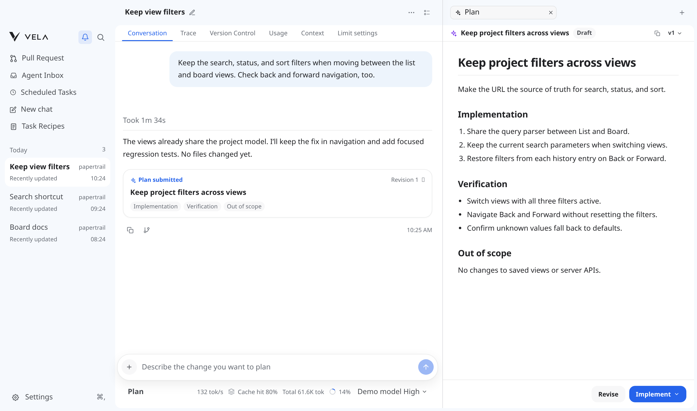
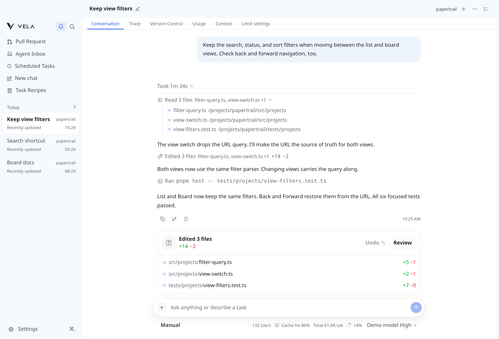
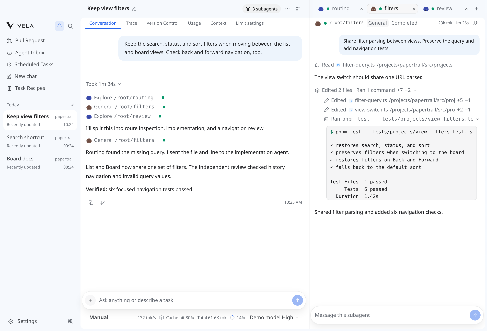
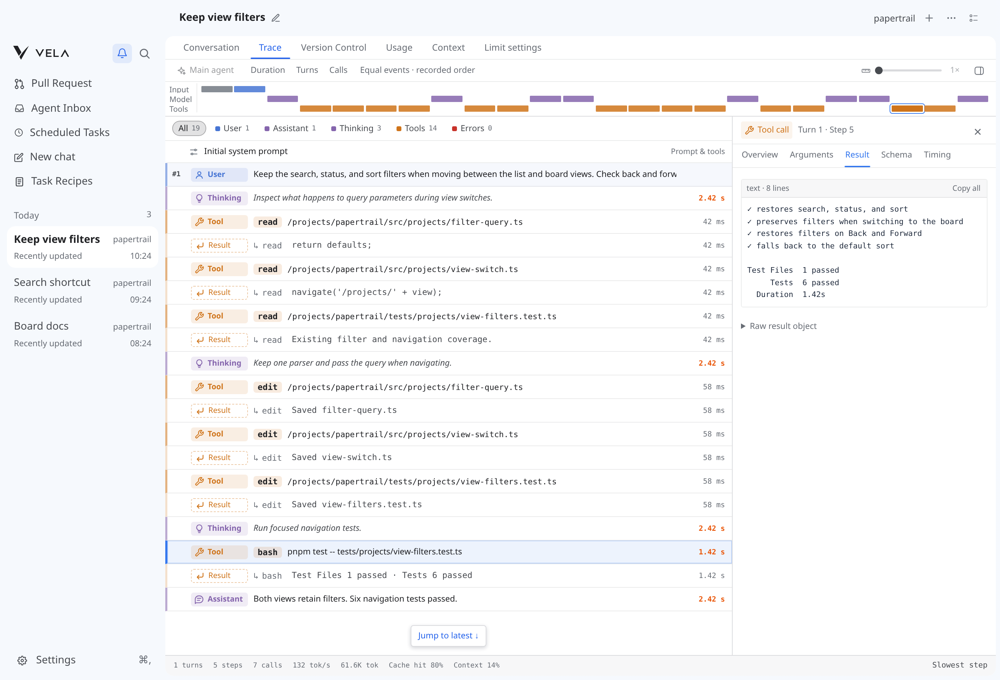
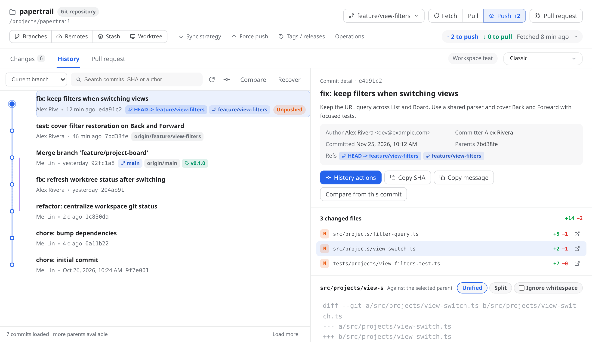
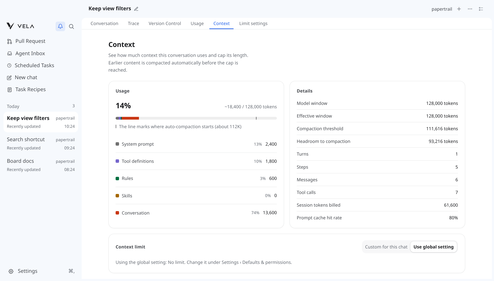
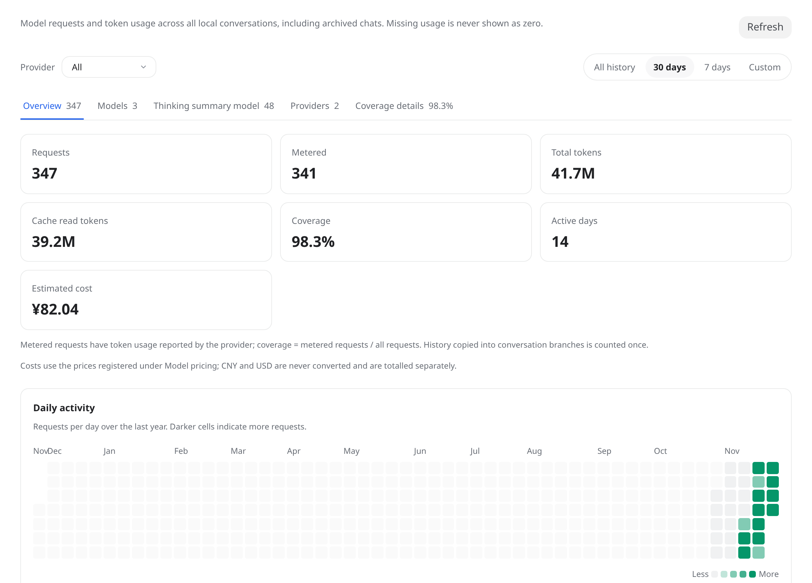
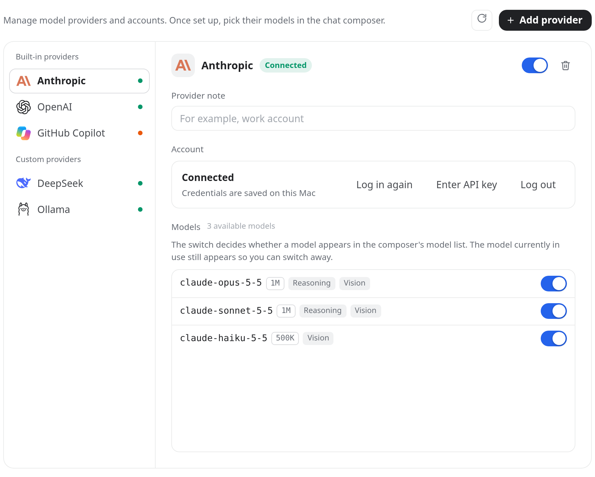
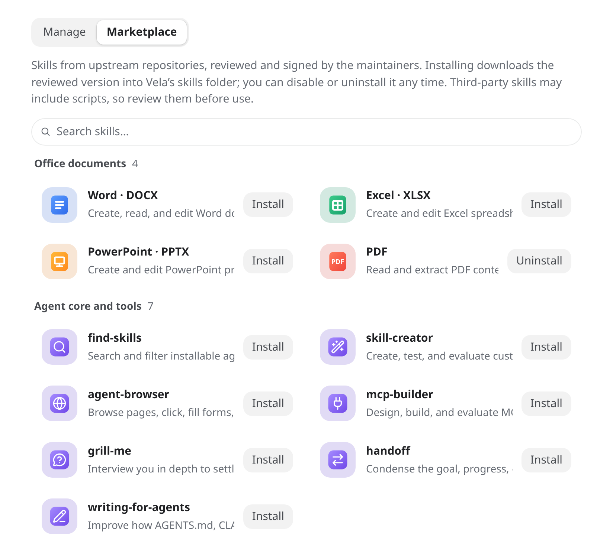

<h1 align="center">Vela</h1>

<p align="center"><strong>A desktop AI coding agent for your local repositories.</strong></p>

<p align="center"><b>English</b> · <a href="./README.zh-CN.md">简体中文</a> · <a href="./README.zh-TW.md">繁體中文</a> · <a href="./README.ja.md">日本語</a> · <a href="./README.ko.md">한국어</a></p>

<p align="center"><a href="https://github.com/KryptonGao/VelaHarness/releases/latest"><strong>Download for macOS</strong></a> · <a href="#workflow">Workflow</a> · <a href="#get-started">Get started</a> · <a href="./docs/README.md">Docs</a></p>

Ask Vela to work in a repository or Git worktree. Review a plan first, hand independent work to subagents, then inspect the actual changes before you commit.

<p align="center"><a href="./assets/readme/vela-papertrail-review.png"></a><br /><sub>Inspect saved diffs beside the conversation before committing.</sub></p>

## Workflow

The fictional **Papertrail** project loses its filters when switching from List to Board. Follow the same task from plan to review.

<table width="100%"><tr><td width="50%" valign="top"><strong>Plan before editing</strong><br /><a href="./assets/readme/vela-papertrail-plan.png"></a><br /><sub>Review the proposed steps and tests before approving execution.</sub></td><td width="50%" valign="top"><strong>Compact mode</strong><br /><a href="./assets/readme/vela-papertrail-compact.png"></a><br /><sub>Reads, edits and commands stay in an expandable activity log.</sub></td></tr></table>

<table width="100%"><tr><td width="50%" valign="top"><strong>SubAgents</strong><br /><a href="./assets/readme/vela-papertrail-subagents.png"></a><br /><sub>Inspect an implementation agent beside the main conversation.</sub></td><td width="50%" valign="top"><strong>Trace view</strong><br /><a href="./assets/readme/vela-papertrail-trace.png"></a><br /><sub>Select a timeline event to see its command, result and timing.</sub></td></tr></table>

**Agent** handles everyday edits. **Plan** proposes changes for approval. **Goal** keeps track of progress toward a larger outcome. See the [Plan mode guide](./docs/features/plan-mode.md).

## Workspace and usage

Inspect Git history, see what goes into the model’s context, and track requests and tokens. Costs use the prices you enter; CNY and USD are totaled separately.

<table width="100%"><tr><td width="50%" valign="top"><strong>Git history</strong><br /><a href="./assets/readme/vela-papertrail-git.png"></a><br /><sub>Follow branches and inspect commits in the workspace.</sub></td><td width="50%" valign="top"><strong>Context</strong><br /><a href="./assets/readme/vela-papertrail-context.png"></a><br /><sub>See what fills the model’s context window and how much room is left.</sub></td></tr></table>

<table width="100%"><tr><td width="50%" valign="top"><strong>Usage and cost</strong><br /><a href="./assets/readme/vela-papertrail-usage.png"></a><br /><sub>Track requests, tokens and costs estimated from the prices you enter.</sub></td><td width="50%" valign="top"><strong>Models and accounts</strong><br /><a href="./assets/readme/vela-papertrail-models.png"></a><br /><sub>Manage providers and add custom model endpoints.</sub></td></tr></table>

## Extend Vela

Give recurring work its own instructions, schedule or recipe.

### Skill marketplace

<p align="center"><a href="./assets/readme/vela-papertrail-skills.png"></a><br /><sub>Discover reusable Skills and manage the ones available to the agent.</sub></p>

> Click any screenshot for the original. The screenshots come from development snapshot 5afd78e and show Vela’s actual renderer with fictional projects, chats, test results, timings and prices. These are not benchmarks or captures of the native macOS window.

### Beyond the conversation

[Scheduled tasks](./docs/features/scheduled-tasks.md) · [Task recipes](./docs/features/task-recipes.md) · [MCP servers](./docs/features/mcp.md) · [Built-in integrations](./docs/features/built-in-mcp-plugins.md) · [Split workbench](./docs/features/workbench-split.md) · [Embedded browser](./docs/features/browser.md)

## Get started

1. Download the **macOS Apple Silicon** build from [Releases](https://github.com/KryptonGao/VelaHarness/releases/latest). The `.dmg` is the installer; the `.zip` contains the app bundle. Verify the download with `SHA256SUMS.txt`. Builds are ad-hoc signed and not notarized; see [installation and update notes](./docs/guides/updates.md) if macOS blocks the first launch.
2. In **Settings → Models & accounts**, sign in or add a custom model endpoint.
3. Open a project folder or worktree, pick a task mode, and describe the change.

## Permissions and local data

Vela executes locally in a workspace or Git worktree. Choose manual approval, model-assisted approval or full access. These control confirmation prompts and are not OS-level sandboxing. Chats, settings and traces live in `~/.vela`; the development build uses `~/.vela-dev`. See [permission rules](./docs/features/permission-rules.md) and [workspace checkpoints](./docs/features/checkpoints.md).

## Develop

Node.js 22.19+ and pnpm 11.24.0 (pinned in the repository):

```sh
pnpm install
pnpm dev
```

`pnpm build` builds the app; `pnpm test` runs type checks and unit tests. For Electron UI checks use `pnpm test:ui`, or build first and run `pnpm test:smoke`.

Vela embeds the [Pi Agent SDK](https://github.com/earendil-works/pi) in Electron. See the [development guide](./docs/guides/development.md), [headless runner](./docs/guides/headless-runner.md) and [project docs](./docs/README.md).

## License

[Apache-2.0](./LICENSE)
