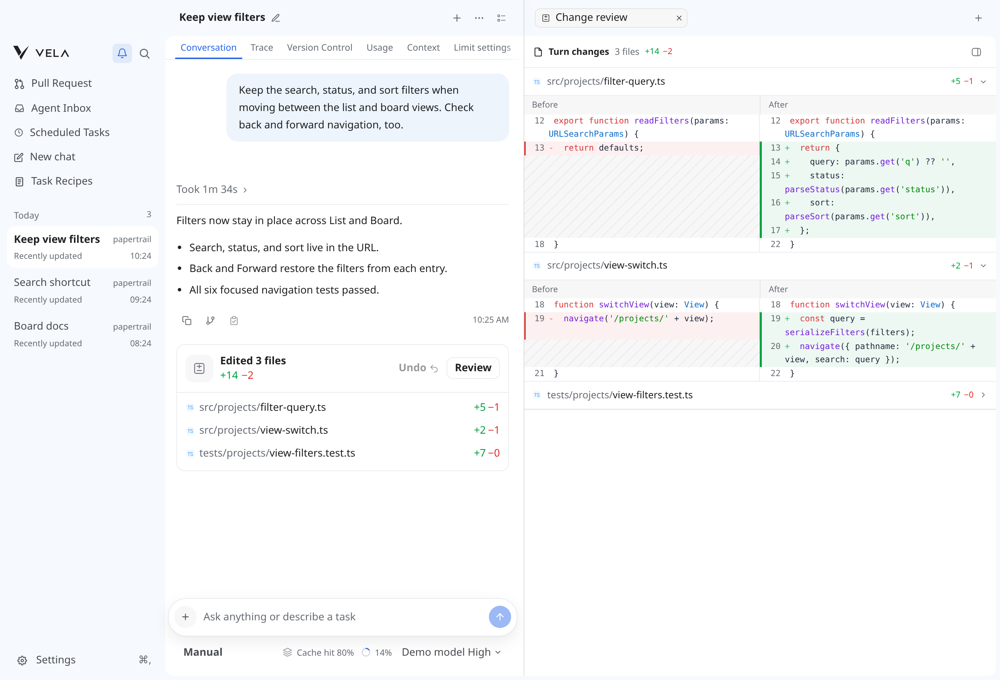
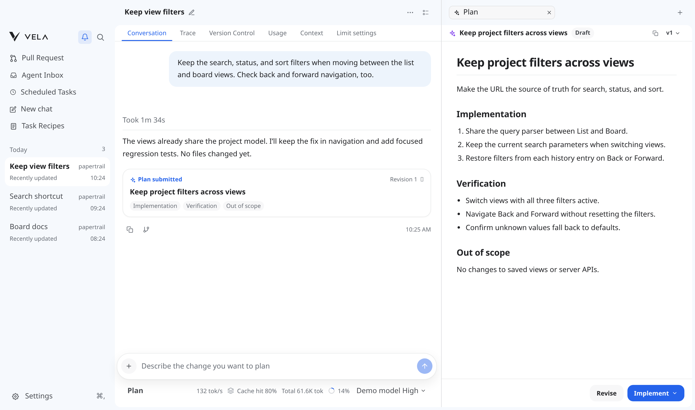
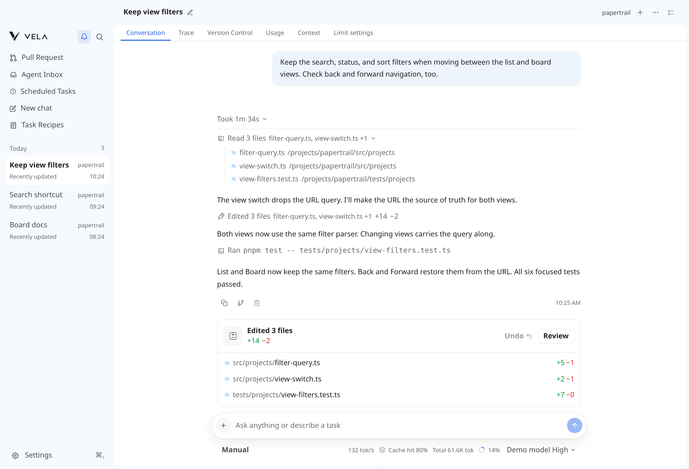
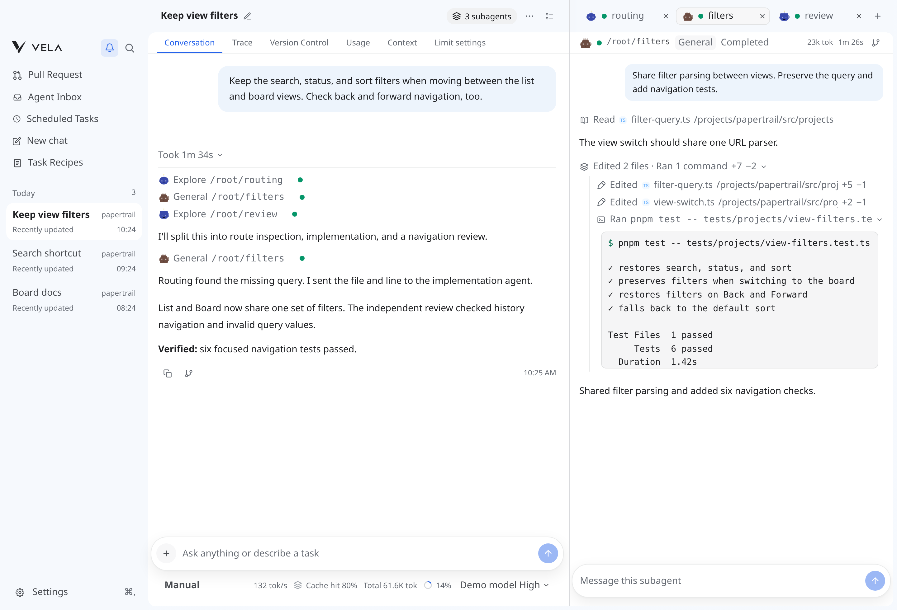
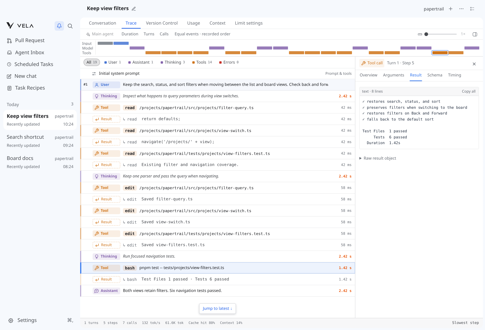
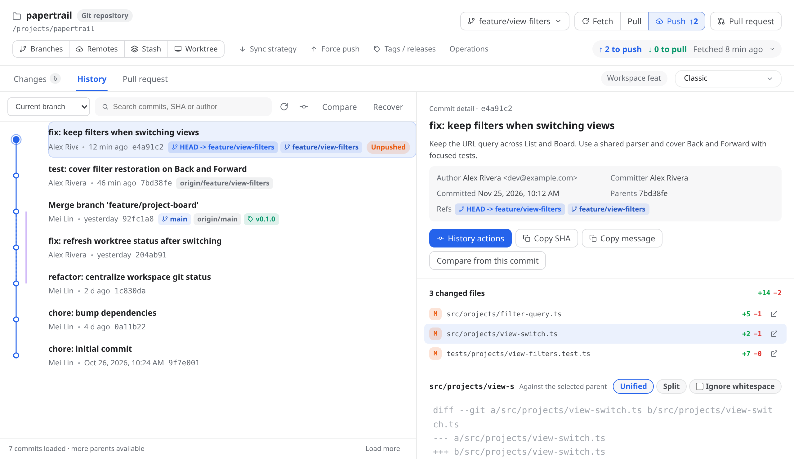
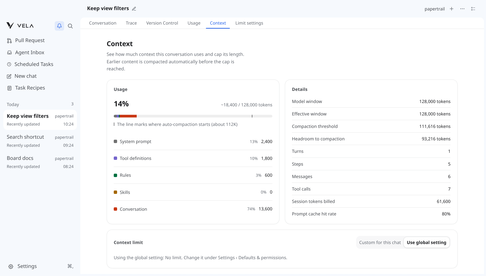
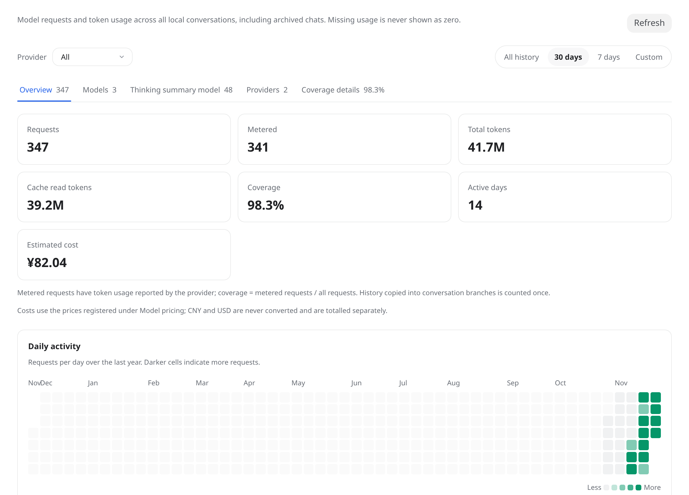
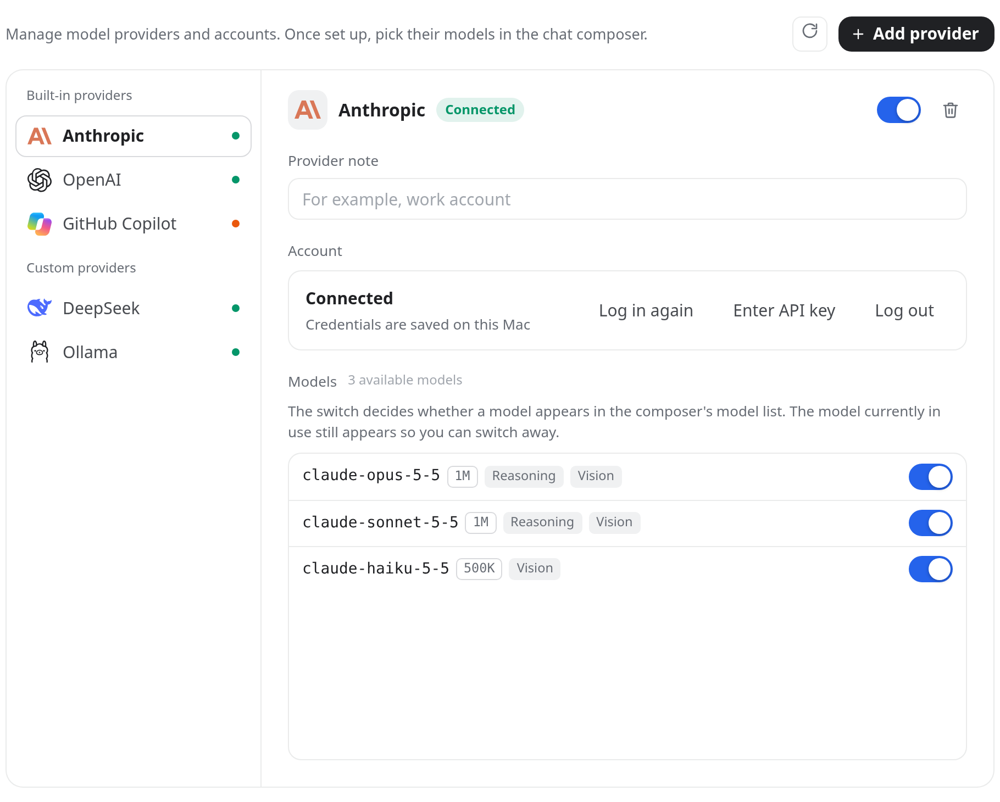
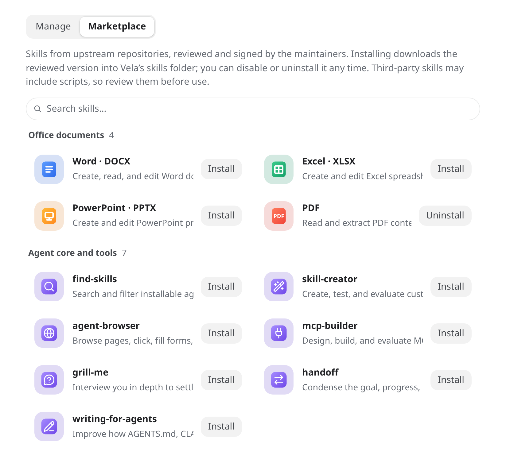

<h1 align="center">Vela</h1>

<p align="center"><strong>为本地代码仓库而做的桌面 AI 编程助手。</strong></p>

<p align="center"><a href="./README.md">English</a> · <b>简体中文</b> · <a href="./README.zh-TW.md">繁體中文</a> · <a href="./README.ja.md">日本語</a> · <a href="./README.ko.md">한국어</a></p>

<p align="center"><a href="https://github.com/KryptonGao/VelaHarness/releases/latest"><strong>下载 macOS 版</strong></a> · <a href="#工作流程">工作流程</a> · <a href="#快速开始">快速开始</a> · <a href="./docs/README.md">文档</a></p>

选一个本地仓库或 Git worktree，让 Vela 在里面工作。先看方案，把能并行的部分分给子代理；最后对照实际改动，决定提交什么。

<p align="center"><a href="./assets/readme/vela-papertrail-review.png"></a><br /><sub>左边保留对话，右边逐文件对照修改前后的代码。</sub></p>

## 工作流程

假设有个叫 **Papertrail** 的项目，列表切到看板后会丢失筛选条件。下面用同一个任务，展示从出方案到看改动的过程。

<table width="100%"><tr><td width="50%" valign="top"><strong>先看方案</strong><br /><a href="./assets/readme/vela-papertrail-plan.png"></a><br /><sub>先审阅实施步骤、验证方法和范围，再决定是否执行。</sub></td><td width="50%" valign="top"><strong>紧凑模式</strong><br /><a href="./assets/readme/vela-papertrail-compact.png"></a><br /><sub>读取、编辑和命令收在可展开的过程行里，不淹没回答。</sub></td></tr></table>

<table width="100%"><tr><td width="50%" valign="top"><strong>子代理</strong><br /><a href="./assets/readme/vela-papertrail-subagents.png"></a><br /><sub>主对话汇总任务，右侧标签页打开子代理自己的运行记录。</sub></td><td width="50%" valign="top"><strong>轨迹视图</strong><br /><a href="./assets/readme/vela-papertrail-trace.png"></a><br /><sub>在时间线上选中事件，看命令、返回结果和耗时。</sub></td></tr></table>

**Agent** 用于日常读写，**Plan** 先提方案、等你批准，**Goal** 持续跟进较大的目标。详见 [Plan 模式说明](./docs/features/plan-mode.md)。

## 工作区与用量

看清 Git 历史、模型上下文和实际请求用量。费用按你填写的单价估算，人民币和美元分别汇总，不自动换算。

<table width="100%"><tr><td width="50%" valign="top"><strong>Git 历史</strong><br /><a href="./assets/readme/vela-papertrail-git.png"></a><br /><sub>沿分支图查看提交及其改动，不用离开工作区。</sub></td><td width="50%" valign="top"><strong>上下文</strong><br /><a href="./assets/readme/vela-papertrail-context.png"></a><br /><sub>看系统提示词、工具、规则和对话各占多少，还有多少余量。</sub></td></tr></table>

<table width="100%"><tr><td width="50%" valign="top"><strong>用量与费用</strong><br /><a href="./assets/readme/vela-papertrail-usage.png"></a><br /><sub>查看请求与 Token 用量，按自己填写的价格估算费用。</sub></td><td width="50%" valign="top"><strong>模型与账号</strong><br /><a href="./assets/readme/vela-papertrail-models.png"></a><br /><sub>管理供应商账号，也可以添加自己的模型端点。</sub></td></tr></table>

## 扩展 Vela

把重复工作变成 Skill、定时任务或可复用的任务配方。

### 技能市场

<p align="center"><a href="./assets/readme/vela-papertrail-skills.png"></a><br /><sub>浏览可复用的 Skill，管理哪些可以交给代理使用。</sub></p>

> 点击图片可看原图。截图来自 Vela 开发快照 5afd78e 的真实界面组件；项目、会话、测试输出、耗时和单价均为演示数据，不代表实测或厂商定价。截图不含 macOS 原生窗口层。

### 对话之外

[定时任务](./docs/features/scheduled-tasks.md) · [任务配方](./docs/features/task-recipes.md) · [MCP 服务](./docs/features/mcp.md) · [内置集成](./docs/features/built-in-mcp-plugins.md) · [分屏工作台](./docs/features/workbench-split.md) · [内嵌浏览器](./docs/features/browser.md)

## 快速开始

1. 从 [Releases](https://github.com/KryptonGao/VelaHarness/releases/latest) 下载 **macOS Apple Silicon** 版。`.dmg` 用于安装，`.zip` 内是应用本体；可以用 `SHA256SUMS.txt` 核对文件。构建采用临时签名，未经 Apple 公证；若 macOS 阻止首次打开，参见[安装与更新说明](./docs/guides/updates.md)。
2. 到 **设置 → 模型与账号** 登录供应商，或添加自定义模型端点。
3. 打开项目目录或 worktree，选一个任务模式，描述要改什么。

## 权限与数据

Vela 在本地工作区或 Git worktree 执行任务。你可以选择手动确认、由模型辅助审批，或完整访问。这些是确认策略，不是操作系统沙箱。会话、设置和轨迹保存在 `~/.vela`，开发版使用 `~/.vela-dev`。详见[权限规则](./docs/features/permission-rules.md)和[工作区检查点](./docs/features/checkpoints.md)。

## 开发

需要 Node.js 22.19+，以及仓库固定的 pnpm 11.24.0：

```sh
pnpm install
pnpm dev
```

`pnpm build` 构建应用，`pnpm test` 运行类型检查与单元测试。要检查真实 Electron 界面，可运行 `pnpm test:ui`，或构建后运行 `pnpm test:smoke`。

Vela 在 Electron 中嵌入 [Pi Agent SDK](https://github.com/earendil-works/pi)。另见[开发指南](./docs/guides/development.md)、[无界面 Runner](./docs/guides/headless-runner.md)和[项目文档](./docs/README.md)。

## 许可证

[Apache-2.0](./LICENSE)
