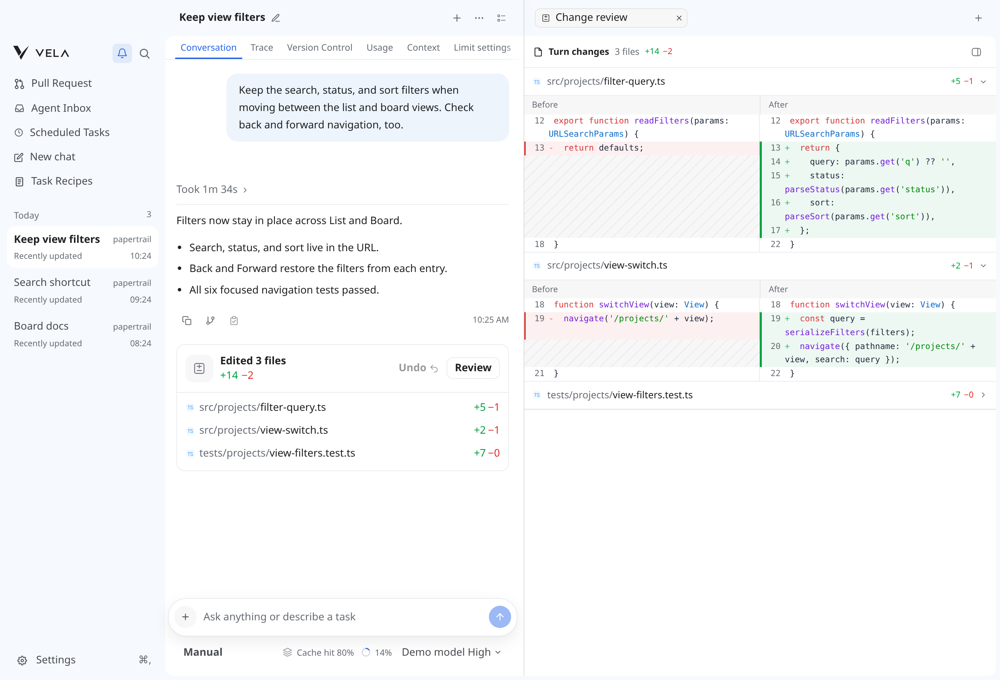
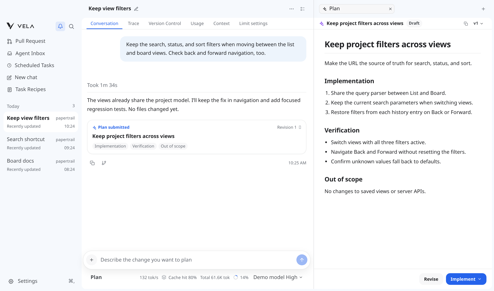
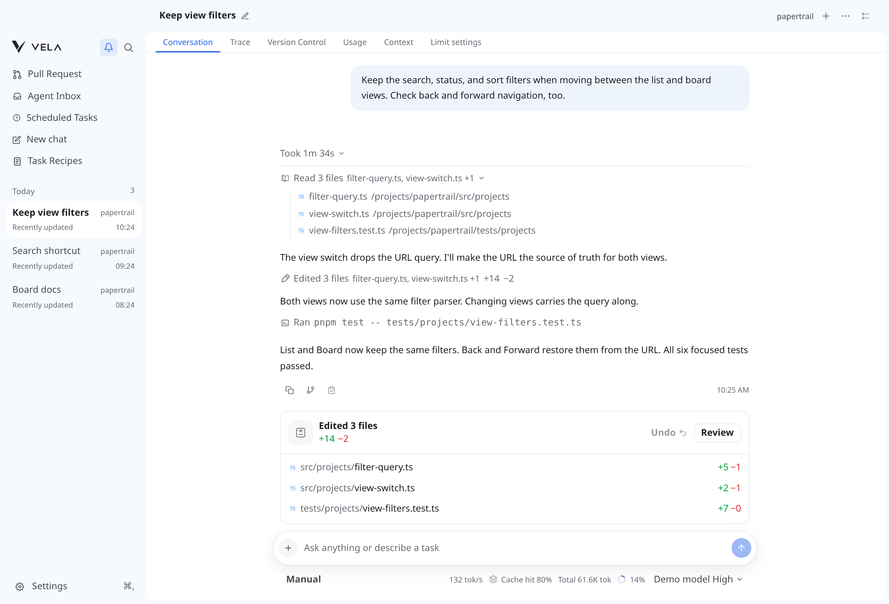
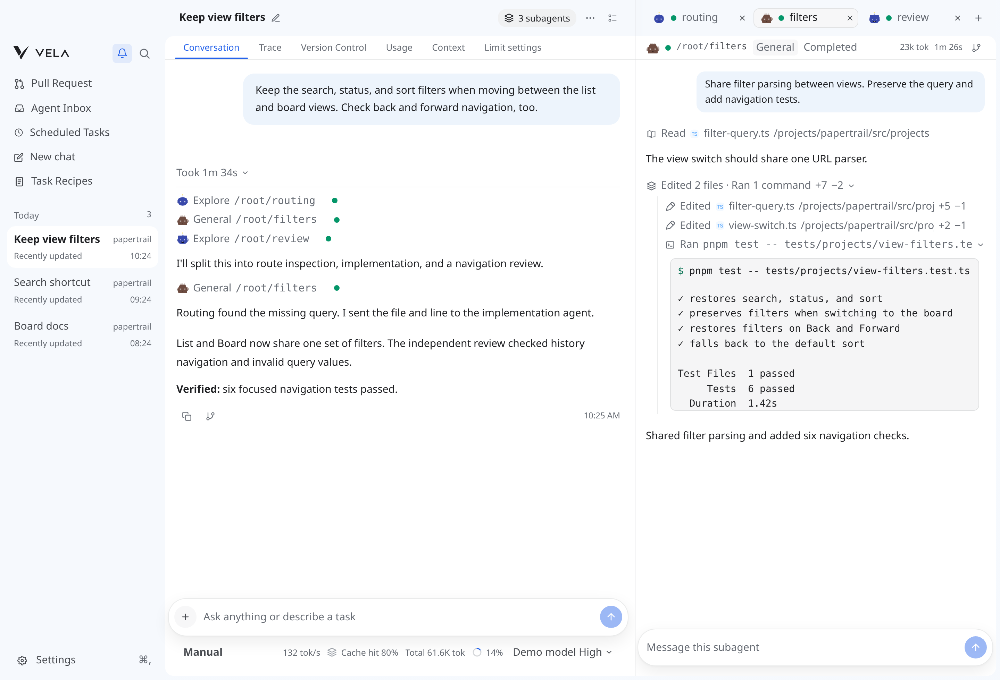
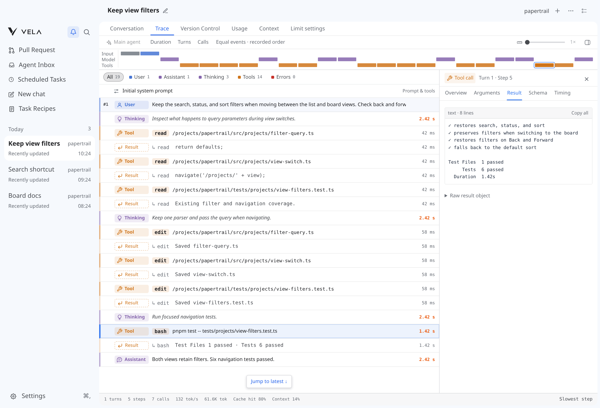
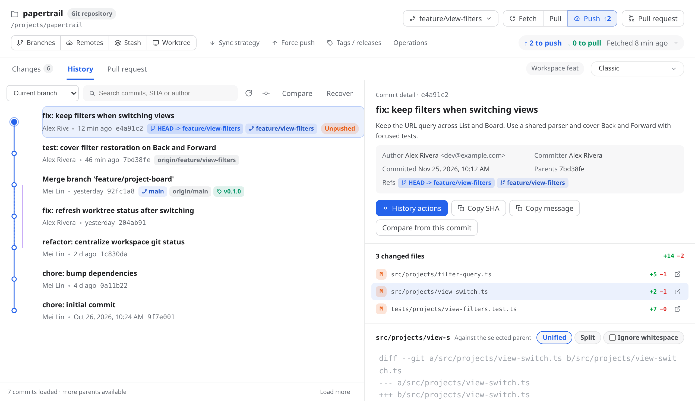
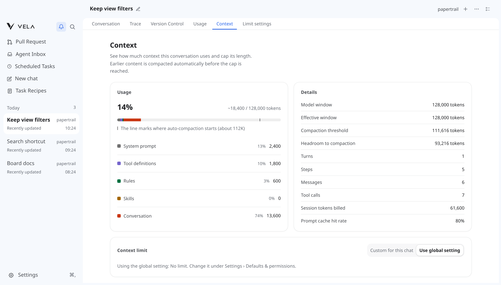
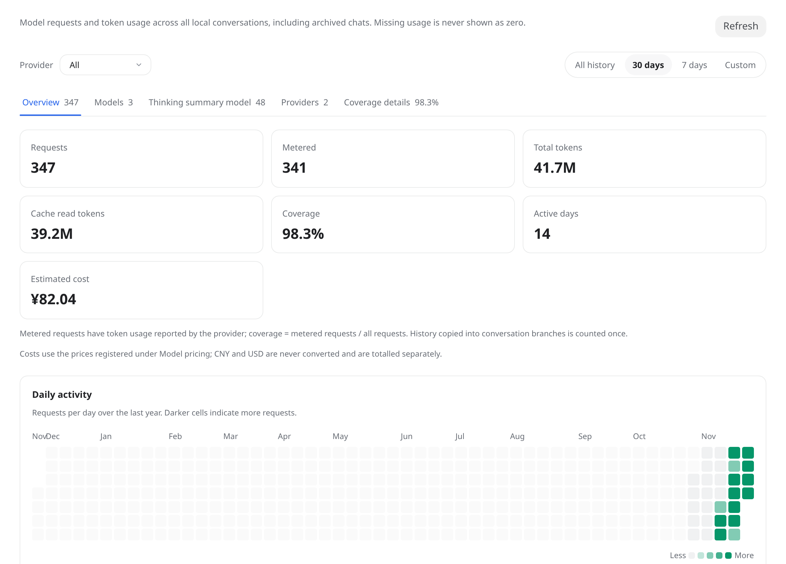
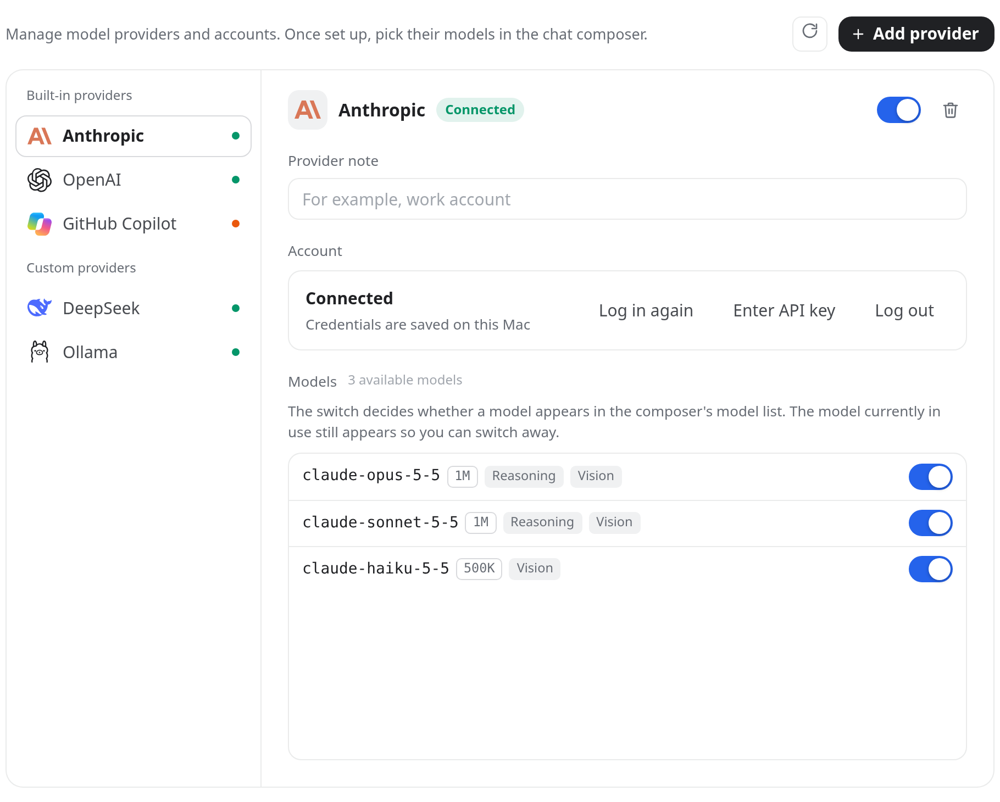
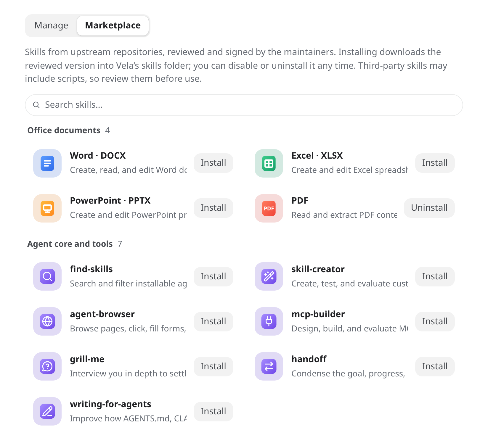

<h1 align="center">Vela</h1>

<p align="center"><strong>為本機程式碼儲存庫打造的桌面 AI 程式設計助理。</strong></p>

<p align="center"><a href="./README.md">English</a> · <a href="./README.zh-CN.md">简体中文</a> · <b>繁體中文</b> · <a href="./README.ja.md">日本語</a> · <a href="./README.ko.md">한국어</a></p>

<p align="center"><a href="https://github.com/KryptonGao/VelaHarness/releases/latest"><strong>下載 macOS 版</strong></a> · <a href="#工作流程">工作流程</a> · <a href="#快速開始">快速開始</a> · <a href="./docs/README.md">文件</a></p>

選一個本機儲存庫或 Git worktree，讓 Vela 在裡面工作。先看計畫，再把能並行的工作分給子代理，最後核對實際變更，決定要提交哪些內容。

<p align="center"><a href="./assets/readme/vela-papertrail-review.png"></a><br /><sub>提交前，在對話旁逐檔比對修改前後的程式碼。</sub></p>

## 工作流程

假設有個叫 **Papertrail** 的專案，從清單切換到看板時會遺失篩選條件。以下用同一個任務示範從規劃到審查的流程。

<table width="100%"><tr><td width="50%" valign="top"><strong>先看計畫</strong><br /><a href="./assets/readme/vela-papertrail-plan.png"></a><br /><sub>核准執行前，先看步驟、測試方法與範圍。</sub></td><td width="50%" valign="top"><strong>緊湊模式</strong><br /><a href="./assets/readme/vela-papertrail-compact.png"></a><br /><sub>讀取、編輯及指令集中在可展開的操作紀錄中。</sub></td></tr></table>

<table width="100%"><tr><td width="50%" valign="top"><strong>子代理</strong><br /><a href="./assets/readme/vela-papertrail-subagents.png"></a><br /><sub>在主對話旁查看負責實作的子代理與其執行紀錄。</sub></td><td width="50%" valign="top"><strong>軌跡檢視</strong><br /><a href="./assets/readme/vela-papertrail-trace.png"></a><br /><sub>在時間軸選取事件，查看指令、結果與耗時。</sub></td></tr></table>

**Agent** 用於日常讀寫，**Plan** 先提出計畫並等待核准，**Goal** 則持續追蹤較大目標的進度。詳見 [Plan 模式指南](./docs/features/plan-mode.md)。

## 工作區與用量

檢查 Git 歷史、模型上下文，以及請求和 Token 用量。費用依你輸入的價格估算，人民幣與美元各自加總，不會換算。

<table width="100%"><tr><td width="50%" valign="top"><strong>Git 歷史</strong><br /><a href="./assets/readme/vela-papertrail-git.png"></a><br /><sub>在工作區內沿著分支圖查看提交及其變更。</sub></td><td width="50%" valign="top"><strong>上下文</strong><br /><a href="./assets/readme/vela-papertrail-context.png"></a><br /><sub>查看上下文各部分的用量，以及剩餘空間。</sub></td></tr></table>

<table width="100%"><tr><td width="50%" valign="top"><strong>用量與費用</strong><br /><a href="./assets/readme/vela-papertrail-usage.png"></a><br /><sub>查看請求數和 Token 用量，並依自訂單價估算費用。</sub></td><td width="50%" valign="top"><strong>模型與帳號</strong><br /><a href="./assets/readme/vela-papertrail-models.png"></a><br /><sub>管理模型供應商，或新增自己的模型端點。</sub></td></tr></table>

## 擴充 Vela

把重複的工作整理成 Skill、排程任務或可重複使用的任務配方。

### 技能市集

<p align="center"><a href="./assets/readme/vela-papertrail-skills.png"></a><br /><sub>瀏覽可重複使用的 Skill，管理代理可以使用的項目。</sub></p>

> 點選圖片可查看原始尺寸。截圖來自 Vela 開發快照 5afd78e 的實際介面。專案、對話、測試結果、耗時和價格都是範例，不代表效能測試或廠商定價；畫面也不包含 macOS 原生視窗。

### 對話之外

[排程任務](./docs/features/scheduled-tasks.md) · [任務配方](./docs/features/task-recipes.md) · [MCP 伺服器](./docs/features/mcp.md) · [內建整合](./docs/features/built-in-mcp-plugins.md) · [分割工作台](./docs/features/workbench-split.md) · [內嵌瀏覽器](./docs/features/browser.md)

## 快速開始

1. 前往 [Releases](https://github.com/KryptonGao/VelaHarness/releases/latest) 下載 **macOS Apple Silicon** 版本。`.dmg` 用來安裝，`.zip` 內含應用程式；可用 `SHA256SUMS.txt` 驗證下載檔案。此版本採臨時簽署，未經 Apple 公證。如果 macOS 阻擋首次啟動，請參考[安裝與更新說明](./docs/guides/updates.md)。
2. 在 **設定 → 模型與帳號** 登入供應商，或新增自訂端點。
3. 開啟專案資料夾或 worktree，選好任務模式並描述要做的變更。

## 權限與本機資料

Vela 在本機工作區或 Git worktree 中執行。可選擇手動確認、模型輔助審核或完整存取。這些選項控制確認提示，不是作業系統沙箱。對話、設定與軌跡儲存在 `~/.vela`，開發版使用 `~/.vela-dev`。請參考[權限規則](./docs/features/permission-rules.md)及[工作區檢查點](./docs/features/checkpoints.md)。

## 開發

需要 Node.js 22.19 或更新版本，以及儲存庫指定的 pnpm 11.24.0。

```sh
pnpm install
pnpm dev
```

`pnpm build` 用來建置應用程式；`pnpm test` 執行型別檢查與單元測試。若要檢查實際的 Electron 介面，可執行 `pnpm test:ui`，或在建置後執行 `pnpm test:smoke`。

Vela 在 Electron 中嵌入 [Pi Agent SDK](https://github.com/earendil-works/pi)。另見[開發指南](./docs/guides/development.md)、[無介面 Runner](./docs/guides/headless-runner.md)與[專案文件](./docs/README.md)。

## 授權

[Apache-2.0](./LICENSE)
