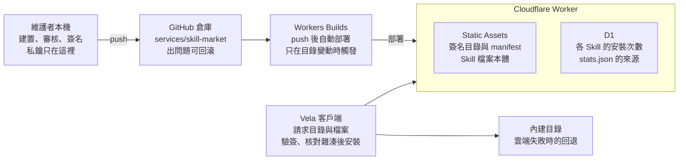

# Vela Skill Market 雲端化 PRD

2026-11-10

## 背景與問題

目前 Skill 市場的目錄寫死在客戶端，安裝又直連 GitHub，所以改目錄要發新版 App，安裝也受 GitHub 限流與網路可達性影響。

- **目錄寫死**：24 個 Skill 定義在 `packages/shared` 的 `marketplaceSkills`，新增、下架、改分類都要發版。
- **直連 GitHub**：客戶端用未認證的 GitHub API 讀取整棵檔案樹，再逐檔從 `raw.githubusercontent.com` 下載；遇到 403 或 429 只能請使用者稍後重試。
- **來源未固定**：安裝時取上游倉庫的 `HEAD`，上游任何改動都會未經審核直接到使用者手上。
- **沒有數據**：無法得知哪些 Skill 真的被安裝。

## 目標與非目標

這次只做維護者自選的目錄，讓它可以不發版就更新，並顯示安裝次數。

**目標**

1. 目錄與 Skill 內容由雲端服務提供，更新目錄不需要發新版 App。
2. 安裝不再依賴 GitHub API，不再受其限流影響。
3. 每個 Skill 固定到經過審核的上游 commit，內容經簽章，客戶端驗證通過才安裝。
4. 市場列表與詳情頁顯示各 Skill 的安裝次數。
5. 雲端不可用時，市場仍能使用內建目錄。

**非目標**

- 社群投稿、使用者帳號、評分與評論。
- 使用者自行上傳 Skill。
- 客戶端的使用行為分析，僅統計安裝次數。
- 跨裝置同步已安裝的 Skill。

## 使用者與情境

有兩類使用者：在 App 裡瀏覽並安裝 Skill 的終端使用者，以及負責篩選和發布目錄的維護者。

| 角色 | 情境 | 期望結果 |
| --- | --- | --- |
| 終端使用者 | 在設定的 Skills 頁瀏覽市場、查看詳情、一鍵安裝 | 目錄載入快；安裝失敗有明確提示；看得到哪些 Skill 較多人安裝 |
| 終端使用者 | 網路不佳或雲端服務暫時不可用 | 仍能看到內建目錄，不會整頁空白 |
| 維護者 | 新增或下架 Skill、把上游的新版本納入目錄 | 在本機審核、簽名後 push，幾分鐘內上線，出問題可回滾 |
| 維護者 | 查看安裝次數 | 從市場目錄直接看到，無需額外工具 |

## 功能需求

服務端提供三項唯讀資源：簽名目錄、每個 Skill 的 manifest、Skill 檔案本體；客戶端依序取用，任一步失敗就回退。

| 編號 | 需求 | 優先級 |
| --- | --- | --- |
| F1 | `GET /v1/catalog.json` 回傳簽名目錄：每筆含 id、名稱、分類、版本、上游來源與固定的 commit、MCP 資訊 | P0 |
| F2 | `GET /v1/skills/:id/manifest.json` 回傳簽名 manifest：檔案清單、各檔案大小與 SHA-256 | P0 |
| F3 | `GET /v1/skills/:id/files/*` 提供 Skill 檔案本體 | P0 |
| F4 | 客戶端驗證目錄與 manifest 簽名，逐檔核對 SHA-256，任何不符就取消安裝 | P0 |
| F5 | 沿用現有安全限制：檔案數、單檔與總大小上限、路徑逃逸檢查、暫存目錄安裝、同名目錄不覆蓋 | P0 |
| F6 | 雲端目錄不可用或驗簽失敗時，回退到內建目錄；內建目錄的安裝仍從雲端分發取檔 | P0 |
| F7 | `GET /v1/stats.json` 回傳各 Skill 的安裝次數，市場列表與詳情頁顯示 | P1 |
| F8 | 維護者用本機指令一鍵建置、簽名、輸出發布內容 | P0 |
| F9 | 所有 API 帶 `/v1` 前綴，往後改格式時不破壞舊版 App | P0 |

目錄資料仍由一份檔案維護，取代目前 `marketplaceSkills` 寫死的清單，作為建置腳本的輸入。

## 安裝統計

安裝次數由服務端在客戶端請求 manifest 時計數，客戶端不發送任何額外請求或標識。

- **計數方式**：只有安裝流程會請求 `manifest.json`，瀏覽目錄不會。Worker 在回傳 manifest 前，對 D1 中該 Skill 的計數加 1。
- **隱私**：服務端不寫入 IP、裝置或使用者資訊，資料表只有 Skill id 與次數。Cloudflare 自身的存取日誌不在本產品控制範圍。
- **精確度**：安裝失敗或重試也可能被計入，數字用來反映受歡迎程度，不作為精確的使用者數。
- **顯示**：次數放在不簽名的 `stats.json`，與簽名目錄分開；數字被竄改只影響顯示，不影響安裝內容的安全。
- **濫用保護**：計數端點加上 Cloudflare 的速率限制，避免單一來源刷高次數；不為此儲存 IP。
- **統計取用**：`stats.json` 加邊緣快取（建議數分鐘），客戶端載入失敗時不顯示次數即可，不影響安裝。

## 安全與簽章

Skill 會進入 Agent 的上下文，也可能帶腳本，所以即使雲端服務或 Cloudflare 帳號被入侵，攻擊者也不能推出未經簽名的內容。

1. **專用簽名金鑰**：市場使用一把新的金鑰，不與發版用的 update 金鑰共用。私鑰只存在維護者本機，不進倉庫、不進 Cloudflare、不進 CI。
2. **公鑰內建**：App 內建公鑰清單，支援多把公鑰，以便將來輪換金鑰。
3. **簽名範圍**：目錄和每個 manifest 各自簽名，manifest 記錄每個檔案的路徑、大小與 SHA-256。
4. **固定上游 commit**：每個 Skill 記錄維護者審核過的上游 commit SHA，建置時只從該 commit 取檔，不再取 `HEAD`。更新上游版本必須由維護者重新審核並發布。
5. **客戶端驗證**：先驗簽名，再逐檔核對哈希；簽名無效、哈希不符、檔案不在 manifest 內，一律取消安裝且不留下半個 Skill。
6. **回退目錄同樣驗證**：內建目錄只提供列表，實際安裝仍必須通過 manifest 驗簽。

不再對使用者開放直連 GitHub 的安裝路徑，避免繞過簽名。

## 技術架構與部署

服務放在同一個倉庫的 `services/skill-market`，由 Cloudflare Workers 提供，push 之後自動部署。

維護者在本機建置並簽名，push 後由 Workers Builds 部署；客戶端取得內容後先驗簽，雲端失敗就回退到內建目錄。

- **倉庫位置**：monorepo 內新增一個 workspace 套件，用獨立的 `tsconfig` 與測試命令，不與 Electron 的型別混在一起。
- **部署**：Workers Builds 連接 GitHub，Root directory 指向該目錄，Watch paths 只在該目錄變動時觸發；部署指令先套用 D1 的資料表結構，再執行 `wrangler deploy`。
- **內容分發**：目錄、manifest 與 Skill 檔案由 Static Assets 提供；實測超過上限時，Skill 檔案改放 R2。
- **路由**：只有 manifest 路由先經過 Worker 計數，其他靜態檔案直接回應。
- **建置**：本機執行建置指令（暫定名稱 `pnpm market:build`），從固定的 commit 取檔、產生 manifest 並簽名，輸出到 `public/`，再 commit 並 push。
- **一次性設定**：在 GitHub 授權 Cloudflare 存取這個倉庫，並在 Cloudflare 控制台連接 Worker；由維護者自己操作。

## 客戶端變更與相容性

客戶端改動集中在 `packages/agent/src/skill-marketplace.ts`，現有的安全限制和安裝流程都保留。

- **安裝來源**：把「讀 GitHub 檔案樹、逐檔下載」改成「取簽名 manifest、逐檔下載並核對哈希」。重試、逐檔並發下載、`safeJoin` 與暫存目錄照舊。
- **驗簽函式位置**：現有 `verifySignature` 在 `apps/desktop/src/main`，而 `packages/agent` 不能反向依賴桌面端。將其移到 `packages/shared`，或由呼叫端注入，實作時再決定，偏好前者。
- **目錄來源**：啟動時請求 `catalog.json`；失敗、逾時或驗簽不過就用內建的 `marketplaceSkills`。內建目錄由建置時的同一份目錄檔產生，避免兩份清單不一致。
- **統計顯示**：市場列表與詳情頁顯示安裝次數，載入失敗就不顯示。新增文案按專案慣例提供 zh-CN 與 en，並補 zh-TW、ja、ko。
- **API 版本**：路徑帶 `/v1`；老版 App 只認 `/v1`，日後破壞性變更開 `/v2`，兩個版本並存一段時間。
- **已安裝的 Skill**：不受影響，安裝位置和「同名目錄不覆蓋」的行為維持不變。

## 里程碑與驗收標準

分四個里程碑，前三個各有一道驗收關卡；目前還沒有排定日期，等待決事項確認後再排。

- **M0 實測與定案**：實測 24 個 Skill 的總檔案數與體積，決定用 Static Assets 還是 R2；定案網域與簽名金鑰。
- **M1 服務與簽章**：建置指令能產生簽名的目錄與 manifest；Worker 部署後，三項唯讀資源都能存取；客戶端驗簽函式就緒。關卡：驗簽無效、雜湊不符的測試都通過。
- **M2 客戶端切換**：安裝改走 manifest；簽名無效、哈希不符、路徑逃逸、超過大小上限都會取消安裝且不留殘檔；雲端不可用時目錄回退到內建目錄。關卡：這些情境的測試通過。
- **M3 安裝統計**：安裝一次，對應 Skill 的次數加 1，瀏覽目錄不會；列表與詳情頁顯示次數；五個語系的文案都已提供。

## 風險與待決事項

最大的風險是 Static Assets 的檔案數與大小上限，需要先實測；其餘風險都有明確的回退方式。

| 風險 | 影響 | 因應 |
| --- | --- | --- |
| Static Assets 檔案數或單檔大小超過上限（官方數字需再確認） | 部署失敗 | 實作前先實測 24 個 Skill 的總檔案數與體積；超上限改為 manifest 放 git、檔案放 R2 |
| 倉庫因 vendor Skill 檔案而變大 | clone 與 CI 變慢 | 同上；或只保留最新一版的檔案 |
| 簽名私鑰遺失 | 無法發布新目錄 | 備份私鑰；公鑰清單支援多把，可用 App 更新加入新公鑰 |
| 簽名私鑰外洩 | 攻擊者可簽發惡意內容 | 立即汰除該公鑰，發布新版 App 與新金鑰 |
| 上游倉庫改名或刪除 | 新版本無法建置 | 因為已 vendor 進本倉庫，既有 Skill 不受影響 |
| 中國大陸使用者連 Cloudflare 不穩定 | 目錄載入慢 | 先用內建目錄回退；如有需要再評估香港或新加坡的 VPS |
| 計數被刷高 | 次數失真 | 速率限制；次數只作為參考 |

**待決事項**

- [ ] 自訂網域名要用哪個。
- [ ] 簽名金鑰是否如本文建議新建一把，私鑰存放在哪。
- [ ] 驗簽函式移到 `packages/shared`，還是由呼叫端注入。
- [ ] 實測結果出來後，決定 Skill 檔案放 Static Assets 還是 R2。
- [ ] 是否需要測試香港或新加坡的備援節點，取決於中國大陸使用者占比。
